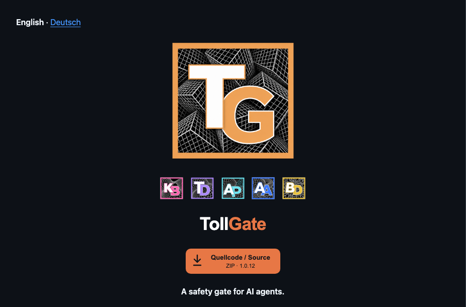

# README-Kopf der Produktfamilie · readme-header-v1

**Status: verbindliche Designrichtung, vom Nutzer am 08.11.2026 freigegeben
(„genauso sollen die READMEs aussehen“).** Gilt für jedes Tool der Familie,
unabhängig vom Inhalt des README. Gemeinsame Quelle ist ThreadDesk, wie beim
[Appbar-Vertrag](appbar-v1.md). Wird ein neues Tool angelegt oder bekommt ein
Tool neue Icons, wird dieser Kopf übernommen — nicht neu erfunden.



Ebenfalls festgehalten: KI-Zentrale [D-013](https://github.com/landjunge/KI-Zentralle/blob/main/DECISIONS.md),
globale `~/.claude/CLAUDE.md` und die erste Zeile jedes Produkt-README.

Live-Referenzen (Stand 08.11.2026):
[KiraBridge](https://github.com/landjunge/KiraBridge#readme) ·
[ThreadDesk](https://github.com/landjunge/threaddesk#readme) ·
[4AllPass](https://github.com/landjunge/4AllPass#readme) ·
[TollGate](https://github.com/landjunge/tollgate#readme) ·
[Agent Authority](https://github.com/landjunge/agent-authority-lab#readme) ·
[BlockDesign](https://github.com/landjunge/blockdesign#readme)

## Bestandteile

| Datei | Rolle |
|---|---|
| `docs/contracts/readme-header-v1.md` | diese Regel |
| `docs/contracts/readme-header-v1.json` | Produktkatalog: Reihenfolge, Namen, Repos, Markenfarben, Wortmarken, Download-Art |
| `docs/design/readme-header/icons/` | normierte Icons aller Produkte (`<Prefix>-large.svg`, `<Prefix>-small.svg`) |
| `scripts/readme_header.py` | `icons` bauen · `apply` Kopf schreiben · `init` LICENSE+Kopf · `check` prüfen |
| `scripts/update_readme_downloads.py` | Release-Downloads als Direktlinks (wird in Repos mit Releases mitkopiert) |
| `docs/contracts/product-repo-v1.md` | neues Repo: Kopf und Personal-Use-Lizenz gemeinsam anlegen |

## Aufbau (feste Reihenfolge, alles zentriert)

0. **Unsichtbarer Hinweis** in der ersten Zeile: `<!-- readme-header-v1: … -->` — verweist auf
   diese Regel, damit jeder, der den Kopf bearbeitet, sie findet (auf GitHub nicht sichtbar).
1. **Sprachumschalter** `**English** · [Deutsch](README.de.md)` — nur wenn es `README.de.md` gibt.
2. **Großes Produktlogo**, 256 × 256: `assets/readme/normalized/<Prefix>-large.svg`.
3. **Icon-Leiste** mit allen *anderen* Tools, je 48 × 48, getrennt durch `&nbsp;`,
   Reihenfolge wie im Katalog, das eigene Tool fehlt. Jedes Icon ist ein Link auf das
   README des anderen Repos (`https://github.com/landjunge/<repo>#readme`; im deutschen
   README auf `README.de.md`, wenn das Ziel eines hat). `title` = Produktname.
4. **Wortmarke** als `<picture>` mit Dark-/Light-Variante, Breite = 80 % der SVG-Breite.
5. **Download-Buttons** zwischen `<!-- AUTO-DOWNLOADS:START -->` und `<!-- AUTO-DOWNLOADS:END -->`.
6. Danach frei: zentrierte Tagline `<p align="center"><strong>…</strong></p>` und der
   eigentliche Inhalt. Der Kopf ersetzt eine `# Titel`-Zeile (die Wortmarke ist der Titel).

## Gestaltungsregeln

**Icons.** Immer die freigegebenen Dark-PNGs aus `assets/design/icons/dark/` des
jeweiligen Repos, bytegleich als Base64 in eine SVG eingebettet, nur per `clipPath`
auf den farbigen Rahmen zugeschnitten (`frame_box_256` im Katalog) und so skaliert,
dass der Rahmen 94 % der Fläche füllt. Damit wirken alle Icons gleich groß, egal wie
viel Rand das Original hat. Kein Neuzeichnen, keine Buchstaben-Ersatzlogos, keine
Light-Variante in der Leiste. Klein aus der 128-px-, groß aus der 512-px-Datei.

**Wortmarke.** Ein Wort, zweigeteilt: erster Teil neutral (Dark `#ffffff`, Light
`#17191f`), zweiter Teil in der Markenfarbe — wie die Buchstaben im Icon
(KB, TD, AP, TG, AA, BD: zweiter Buchstabe farbig). Arial/Helvetica bold, 44 px,
`letter-spacing -1`, Höhe 64. In der Light-Variante bekommt der farbige Teil eine
feine dunkle Kante (`stroke #17191f 1.1`, `paint-order stroke`), damit helle Farben
wie Türkis oder Gelb auf Weiß lesbar bleiben. Keine Slogans in der Wortmarke.

**Markenfarben** (aus den freigegebenen Icons bzw. `brand/README.md`, identisch mit
dem Appbar-Katalog):

| Tool | Wortmarke | Farbe |
|---|---|---|
| KiraBridge | Kira**Bridge** | `#fc63ad` |
| ThreadDesk | Thread**Desk** | `#b99cff` |
| 4AllPass | 4All**Pass** | `#6be4f2` |
| TollGate | Toll**Gate** | `#e77745` |
| Agent Authority | Agent**Authority** | `#3b78fc` |
| BlockDesign | Block**Design** | `#ebc33f` |

**Download-Buttons.** Ein Klick lädt sofort die Installationsdatei —
`https://github.com/landjunge/<repo>/releases/download/<tag>/<datei>`, **nie** eine
Release-Seite (`/releases/tag/…`). 190 × 52, Fläche in Markenfarbe, Schrift `#14161b`,
Download-Pfeil links, Zeile 1 Plattform (fett), Zeile 2 Version.
Reihenfolge: macOS Apple Silicon, macOS Intel, Windows, Linux.

- Repos mit Releases: `scripts/update_readme_downloads.py` + Workflow
  `readme-downloads.yml`. Nimmt je Plattform die neueste veröffentlichte Datei der
  aktuellen Versionslinie (Installer vor Archiv, keine Prüfsummen/Belege/Wheels).
- Repos ohne Installer: ein Button „Quellcode / Source · ZIP · <Version>“ auf
  `archive/refs/heads/<branch>.zip`, solange das README vom Quellcode aus installiert.

## Neues Tool aufnehmen

1. Icons fertig: `assets/design/icons/{dark,light}/<Prefix>-{dark,light}-<Größe>.png`
   im neuen Repo (mindestens 128, 256, 512).
2. Katalogeintrag in `readme-header-v1.json` **hinten** anhängen: `key`, `name`, `repo`,
   `branch`, `icon_prefix`, `color` (Markenfarbe), `frame_color` (Rahmenfarbe im
   Dark-PNG), `wordmark` (zwei Teile), `wordmark_width` (≈ 36 px je Zeichen),
   `wordmark_dark/light` (Pfade im Repo), `readme_de`, `downloads` (`releases`/`source`,
   bei `source` zusätzlich `source_version`). `frame_box_256` leer lassen.
3. `python3 scripts/readme_header.py icons --product <key> --source <ordner mit den Dark-PNGs>`
   — misst den Rahmen (Pillow) und gibt `frame_box_256` zum Eintragen aus; danach
   eintragen und den Befehl erneut ausführen.
4. `python3 scripts/readme_header.py apply --product <key> --repo <pfad>` im neuen Repo.
5. **Alle bestehenden Repos** ebenfalls mit `apply` aktualisieren — die Icon-Leiste
   wächst überall um das neue Tool.
6. Bei Releases: Markenfarbe in `BRAND` von `scripts/update_readme_downloads.py`
   eintragen, Skript + Workflow ins neue Repo kopieren und einmal ausführen
   (`GITHUB_REPOSITORY=landjunge/<repo> GITHUB_TOKEN=$(gh auth token)`).
7. `check` für jedes Repo, alle Links und Downloads prüfen, PRs öffnen und **sofort
   mergen**; danach die echte GitHub-Startseite ansehen.

Neue Icons für ein bestehendes Tool: Schritt 3 (Katalog-`frame_box_256` vorher leeren),
dann Schritt 5 für alle Repos.

## Prüfen

```sh
python3 scripts/readme_header.py check --product <key> --repo <pfad>
```

Prüft großes Logo, alle Leisten-Icons samt Links, Wortmarke in Markenfarbe,
AUTO-DOWNLOADS-Marker, Direktlinks und dass jede referenzierte Datei existiert.
Zusätzlich vor dem Merge: alle Links des README erreichbar, jeder Download liefert
eine Datei (`content-disposition: attachment`), Ansicht hell und dunkel.

## Nicht wieder tun (Fehler vom 07.11.2026)

- Kleines linksbündiges Icon statt großem zentriertem Logo; Icon-Leiste entfernt.
- Wortmarken-Farben geraten (TollGate teal, 4AllPass blau, KiraBridge violett,
  Agent Authority graublau) statt aus Icon/Katalog genommen.
- Download-Buttons auf Release-Seiten; Plattform-Erkennung, die `x64.dmg`/`aarch64.dmg`
  ohne „mac“ im Namen nicht fand; alte Versionslinien als Download angeboten.
- Fertige Änderung nur als offener PR liegen lassen — auf GitHub sieht man dann nichts.

---

## English summary

Binding README header for every product of the family, approved 08.11.2026,
independent of README content: language switch (if `README.de.md`), large centred
logo (256), row of clickable 48 px icons for all other products (catalog order),
two-tone wordmark (neutral + brand colour), AUTO-DOWNLOADS block whose buttons link
directly to installer files (never release pages). Catalog, normalised icons and
`scripts/readme_header.py` (`icons` / `apply` / `check`) live in ThreadDesk. To add a
tool: add icons, append catalog entry, run `icons`, `apply` to the new repo **and all
existing repos**, `check`, merge.
